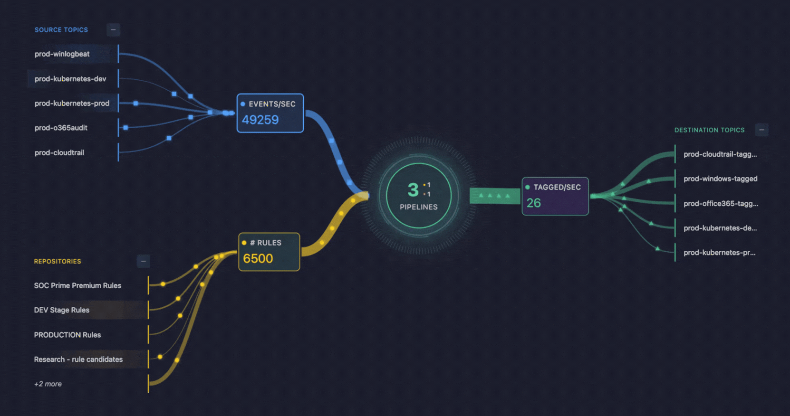
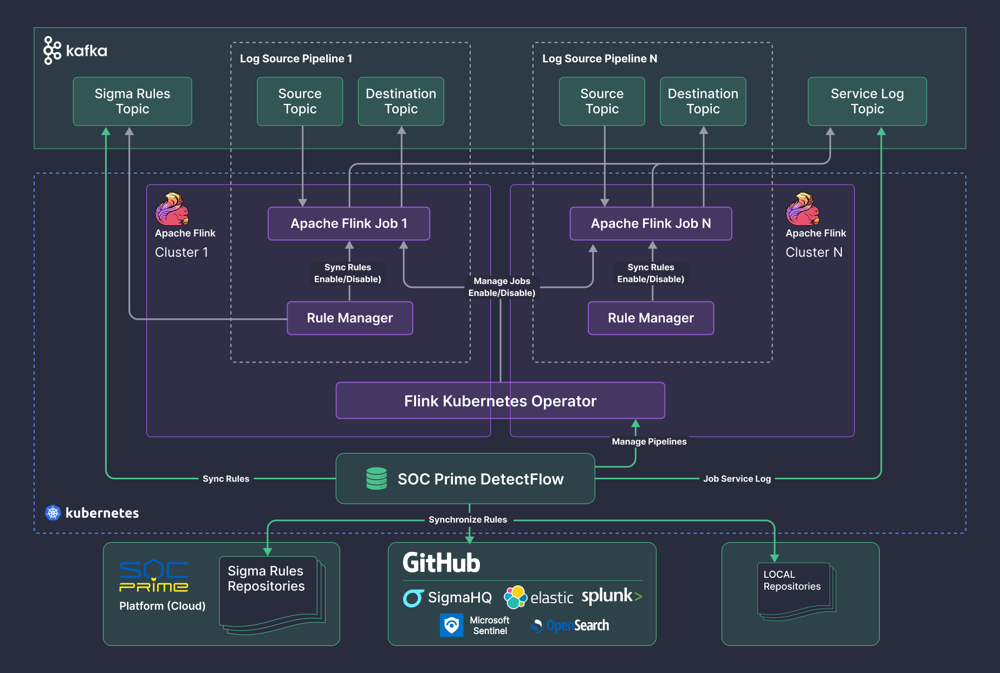

  

  
  &nbsp;&nbsp;&nbsp;
  

DetectFlow is being renamed to Prime Detect. The new name will be reflected across all resources and assets in the next release.

Detection intelligence turbocharged with AI. Enable line-speed detection of cyberattacks by equipping your team with AI trained on 11 years of Detection Intelligence. 

Elevate your daily work from SIEM min-maxing to Detection Orchestration across Data Pipelines, AIDR, EDR, Data Lake, and SIEM. 

Learn more at **[socprime.com](https://socprime.com/)**

- Sub-second MTTD: 0.005–0.01 seconds vs 15+ min for SIEM
- Tags and enriches events in-flight, before SIEM ingestion
- Scales with your infrastructure without vendor-imposed caps
- Applies tens of thousands of Sigma rules on streaming events
- No changes required to SIEM; works with existing ingestion architecture
- Designed for air-gapped and cloud-connected deployment constraints (data stays in your control)

**Result: 10x rule capacity on existing infrastructure.**

## Real-Time Attack Chain Detection

Prime Detect goes beyond single-event matching by correlating detections across multiple events into **Attack Chains**. Here's how an Attack Chain forms:

- **Active Threats:** Active cyberattacks, such as php2shell or node2shell, each described by an Attack Flow, an ATT&CK-mapped sequence of techniques. Active Threats sync automatically from Prime Core (formerly Threat Detection Marketplace), and each includes its detections and a Higher Order Sigma rule.
- **Higher Order Sigma rules:** Each rule is derived from an Active Threat's Attack Flow and describes a multi-event sequence on the same host within a time window. The pipeline evaluates events tagged by Sigma rules against these rules in real time.
- **Attack Chains:** An Attack Chain forms when enough of the rule's sequence matches. Its match percentage shows how much of the Attack Flow has been observed. An Apache Flink agent then enriches the chain with context, reasons over the event sequence, and classifies it as a confirmed detection or a likely false positive.

## Bundled Detection Content

Prime Detect includes a free [detection content set](https://github.com/socprime/detectflow-backend/tree/main/detection_content) covering the latest cyberattacks, built on 11 years of SOC Prime Detection Intelligence: Active Threats, their Higher Order Sigma rules, and the top-100 most effective behavior detection Sigma rules. The content is deployed automatically when you deploy Prime Detect.

## System Architecture

Prime Detect consists of the following projects, each in a separate repo:
- [Prime Detect Backend](https://github.com/socprime/detectflow-backend)
- [Prime Detect UI](https://github.com/socprime/detectflow-ui)
- [Prime Detect MatchNode](https://github.com/socprime/detectflow-matchnode)
- [Prime Detect Schema Parser](https://github.com/socprime/detectflow-parser)
- [Prime Detect Agent](https://github.com/socprime/detectflow-agent)
- [Prime Detect One-click local deployment](https://github.com/socprime/detectflow-one-click-local-deployment)

Consult each project for more details.
## Requirements
### Technology stack:
- Apache Kafka 3.8+ (https://kafka.apache.org/)
- Kubernetes 1.28+ (https://kubernetes.io/)
- PostgreSQL 14+ (https://www.postgresql.org/)
- Apache Flink 1.13+ (can be deployed together with Prime Detect) (https://flink.apache.org/)
 
### Network and infrastructure:

Prime Detect supports two deployment paths, depending on the resources available.

#### Standard deployment: Kubernetes cluster
- Internal access to deployed resources
- Network connectivity between deployed resources
- Kubernetes cluster with at least 3 nodes (workers) (min 8 vCPUs, 32 GiB RAM each).
- Outbound internet access allowed:
   - to *.socprime.com for API access to the SOC Prime Platform for synchronizing detections (optional, API key needed)
   - to *.hub.docker.com for pulling Docker Images
   - to *.github.com for pulling open-source detections using GitHub Integration with public open source repositories, including SigmaHQ, Microsoft, Splunk, and Elastic (optional)

#### Lightweight deployment: Minikube (local, single machine)
For evaluation, testing, or environments where a full Kubernetes cluster isn't available, Prime Detect can also be deployed locally on a single machine using Minikube.

Prerequisites:
 - Ubuntu 22.04 / 24.04 / 26.04
 - Docker Engine running, with your user in the docker group (the script installs Docker if missing)
 - Tuned for a 32 CPU / 64 GB RAM / 128 GB SSD server (minimum ~8 CPU / 16 GB / 40 GB)
 - Outbound internet access allowed:
   - to *.socprime.com for API access to the SOC Prime Platform for synchronizing detections (optional, API key needed)
   - to *.github.com for pulling open-source detections using GitHub Integration with public open-source repositories, including SigmaHQ, Microsoft, Splunk, and Elastic (optional)

In terms of calculating required resources, the following components of Prime Detect should be considered, with individual requirements for each component summed up to estimate the total amount:
- **User Interface Node (Admin Panel)** is the control center to manage event matching processes. This component requires at least 2 CPUs and 4 GB RAM
- **Task Manager Node**, the default component to control the operation of pipelines (based on match nodes, the Apache Flink technology). This component requires at least 1 CPU and 4 GB RAM
- **Match Node**, a pipeline controlled via Admin Panel that matches detection rules to Apache Kafka topic events. The number of Match Nodes (pipelines) is custom, and you should estimate the required Kubernetes cluster resources based on the number of pipelines you're going to create. 

## Deployment
There are two deployment options:
- **Streamlined, "one-click" deployment** to set up the entire Prime Detect ecosystem locally using Docker and Kubernetes (Minikube). The only prerequisite for this option is Ubuntu 24.04 or 26.04. You can find all the details of this approach in a separate repository [detectflow-one-click-local-deployment](https://github.com/socprime/detectflow-one-click-local-deployment).
- **Helm chart deployment** to an existing Kubernetes cluster. The chart deploys the Prime Detect application layer: the Admin Panel backend, the Admin Panel UI, and the supporting resources for the Flink Sigma detector. All images are public on Docker Hub under `socprime/detectflow-oss`, so no registry login or pull secret is needed. For installation steps and configuration options, see [detectflow-helm](https://github.com/socprime/detectflow-helm).

## Getting Started
To start using Prime Detect, follow the instructions from [GETTING_STARTED.md](GETTING_STARTED.md).

## License
Apache License 2.0, see [LICENSE](LICENSE).

